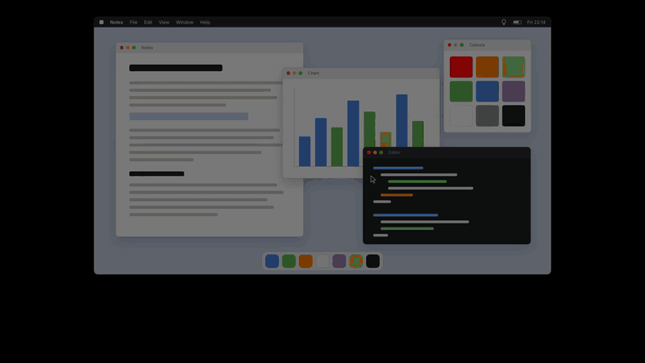

# Red Light

A menu bar app for macOS. It shifts the screen to red light with one click.



The picture above is a drawing made in code. The video with sound is in [media/demo.mp4](media/demo.mp4).

## What it does

- One click on the bulb icon turns red light on or off.
- One key combination, Control-Option-Command-R, does the same from any app.
- The app has three presets: Red, Dim Red and Amber.
- Three sliders set the ceiling of the red, green and blue channels.
- The setting applies to every online display.

## When to use it

- You work late in a dark room.
- You share a bedroom and another person sleeps.
- You look at the stars and you also read a chart on the screen.
- You use a laptop in a cockpit or on a boat at night.

Red Light changes the colour of the screen. It makes no health claim.

## How to use it

| Action | Result |
| --- | --- |
| Click the bulb icon | Red light goes on or off. |
| Press Control-Option-Command-R | Red light goes on or off from any app. |
| Right-click the bulb icon | The menu opens. |
| Control-click or Option-click the bulb icon | The menu opens. |

The bulb icon is an outline when red light is off. The bulb icon is filled and red when red light is on.

The menu has these items:

- **Turn On** or **Turn Off**: the same as a click on the icon.
- **Presets**: Red, Dim Red and Amber. A check mark shows the preset that is equal to the current setting. A preset turns red light on. The source gives the first nine presets the key equivalents 1 to 9 in the menu.
- **Tune**: the sliders Red, Green and Blue. Each slider goes from 0 to 1. A slider turns red light on, and the screen changes while you move it.
- **Save Current as Preset…**: gives the current slider setting a name. The new preset replaces a preset with the same name.
- **Delete Preset**: a submenu with each preset and "Restore Default Presets". The app does not delete the last preset.
- **Open at Login**: starts the app when you log in. A check mark shows that the app starts at login.
- **Quit Red Light**: restores the normal colours and stops the app.

The default presets have these values:

| Preset | Red | Green | Blue |
| --- | --- | --- | --- |
| Red | 1.0 | 0.0 | 0.0 |
| Dim Red | 0.45 | 0.0 | 0.0 |
| Amber | 1.0 | 0.4 | 0.0 |

## Install from source

Requirements:

- macOS 14.0 or later.
- A Mac with Apple silicon. The script builds for `arm64-apple-macos14`.
- The Swift compiler `swiftc` and the `codesign` tool.

Commands:

```sh
./build.sh            # build only
./build.sh --install  # build, then install and open
```

`./build.sh` does these steps:

1. It deletes the `build` folder and makes it again.
2. It compiles `main.swift` into `build/Red Light.app`.
3. It writes the `Info.plist` file. The app has no Dock icon (`LSUIElement`).
4. It signs the app with an ad hoc signature. The app is not notarized.

`./build.sh --install` also does these steps:

1. It stops a Red Light process that is in operation.
2. It deletes `/Applications/Red Light.app`.
3. It copies the new app to `/Applications`.
4. It opens the app.

## How it works

Red Light sets the display gamma table with `CGSetDisplayTransferByFormula`. For each channel, the minimum stays 0, the gamma stays 1, and the maximum becomes the preset value. Thus the Red preset keeps the red channel and sets green and blue to zero. The app does this for each display that `CGGetOnlineDisplayList` returns. The system can reset the table, so the app applies it again after wake, after a display change, and every 3 seconds. When you turn red light off or quit, the app calls `CGDisplayRestoreColorSyncSettings`.

## Limits and known behaviour

- The app always starts with red light off. It keeps the last colour setting, not the on or off state.
- The key combination is fixed. You cannot change it in the app.
- With the Red preset, pure green and pure blue content shows as black.
- Another program can write a different gamma table. Red Light writes its table again within 3 seconds.
- The app restores the colours when it quits and when it gets SIGTERM, SIGINT or SIGHUP. A forced kill (SIGKILL) does not run that code.
- The build script makes an Apple silicon app only.
- If macOS refuses "Open at Login", the app shows the system error.

## Privacy

- The app stores two items in the macOS user defaults for the identifier `local.redlight`: the preset list and the current setting.
- "Open at Login" registers the app with macOS as a login item. macOS keeps that record.
- The app stores nothing else.
- The source contains no network code. The app sends no data.

## Licence

MIT. See [LICENSE](LICENSE).
